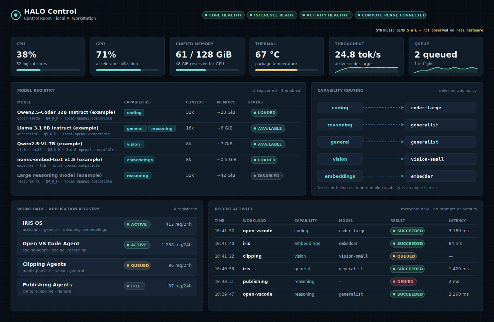
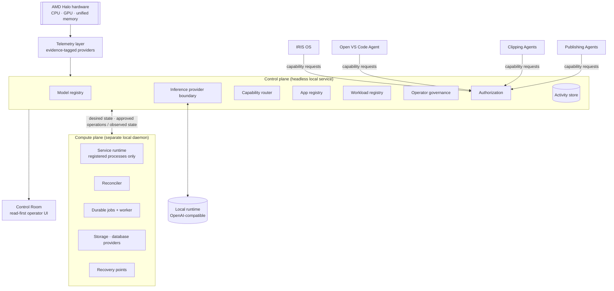

<div align="center">

# HALO Control

**The local control plane for an AMD Halo AI workstation.**

It tracks the hardware, the models, which workload may use which capability, how requests are routed to local inference, which services, storage and jobs each workload is allowed to have, and what actually ran, all on one machine with no cloud dependency.

   



<sub>Control Room, recreated for this public edition with fully synthetic state and the project's real design tokens. No real machine, network or workload data is shown.</sub>

</div>

---

> **Public edition (updated 22 November 2026).** This repository is the public architecture and engineering edition of a private local-infrastructure project. It contains design documentation, illustrative contracts, a small illustrative routing function and synthetic data. It does **not** contain the production implementation, configuration or any infrastructure details. [Scope](#public-repository-scope).

**Latest physical milestone:** real, operator-supervised local model inference and governed 4B/14B-class runtime lifecycle were exercised on AMD Halo hardware on 21–22 November 2026. [Read the sanitized acceptance matrix and its limits](docs/PHYSICAL_ACCEPTANCE_2026-11-22.md). This is a single-host pilot, **not production readiness**.

## Architecture



→ [docs/architecture.md](docs/architecture.md)

## Why HALO exists

Several local AI workloads share one machine: a personal AI operating system, a coding agent, media and publishing pipelines. Without a control plane, each one configures its own model endpoint, keeps its own logs, and competes for the same unified memory blindly. HALO centralizes the shared decisions (which models exist, who may use them for what, where requests go, what ran, whether the machine is healthy) and leaves each workload's logic to the workload.

It is infrastructure. It is not a chatbot or an agent, and it doesn't do any reasoning of its own.

## Major subsystems

| Subsystem | Responsibility |
| --- | --- |
| **Telemetry** | Machine health with an explicit evidence class per signal |
| **Model registry** | Versioned inventory of models, capabilities, context sizes and resource needs |
| **Inference boundary** | Provider-neutral local inference (disabled / mock / OpenAI-compatible HTTP) |
| **Capability router** | Capability → model, deterministic, declared policy, no silent fallback |
| **Application registry + authorization** | Per-workload identity and capability allowlists |
| **Activity store** | Local SQLite history of what ran; metadata only |
| **Workload registry** | Desired state per application: storage, database, job types, services |
| **Compute plane** | A separate daemon that owns execution and observed state: service runtime, reconciler, durable jobs, storage and database providers, recovery points |
| **Operator governance** | Local operator session, durable proposals and approvals, execution-time revalidation, global force-read-only |
| **Control Room** | Read-first operator UI that validates every response it renders; mutations go through approvals |

## Local inference

Workloads never call a model runtime directly. HALO resolves the capability to a registered model, checks that the model is enabled and capable, and calls the runtime through an OpenAI-compatible HTTP boundary with a timeout. The endpoints and internal model references stay server-side. Inference is **off by default** and has to be enabled explicitly. → [docs/local-first-design.md](docs/local-first-design.md)

## Model registry

Each model record holds its family, size, quantization, context window, capabilities, input modalities, approximate memory and provider. **Registration is not availability**: the registry says what HALO knows about, and the provider says what is actually loadable or loaded. → [docs/model-registry.md](docs/model-registry.md)

## Capability routing

```
Task → required capability → declared candidates → eligibility + resource checks → selected model & runtime
```

Routing remains deterministic and driven by versioned policy checked against the registry. In the private hardware pilot, admitted dispatch is pinned to the approved runtime generation; lifecycle starts are gated by observed memory headroom. This does **not** mean the system automatically chooses an optimal model, migrates in-flight work or evicts external processes. This public repo includes a small **illustrative** router you can run:

```bash
node --experimental-strip-types examples/route-demo.ts
```

→ [docs/capability-routing.md](docs/capability-routing.md)

## Compute plane and service runtime

The control plane decides what *should* exist; a separate daemon executes and reports what *does*. It accepts a small set of typed operations on registered ids (no commands, no shell), tracks only processes it started, never restarts anything automatically, and reports a possibly orphaned process as `unknown` rather than guessing. Workload changes go through a previewed, digest-guarded, journalled reconciliation that an operator approves. → [docs/service-runtime.md](docs/service-runtime.md) · [docs/operations-and-recovery.md](docs/operations-and-recovery.md)

## Telemetry

CPU, GPU, unified memory (including the GPU-reserved share), temperature, active model, throughput and queue depth where supported. The private physical pilot also observes per-runtime resource attribution and explicit occupancy freshness. Every signal carries an evidence class (`mocked`, `local-real`, `halo-real` or `unavailable`), so the Control Room never shows a guess as a measurement. Project reporting uses the same discipline with a wider vocabulary, and a higher class is never inferred from a lower one. → [docs/telemetry.md](docs/telemetry.md)

## Workloads

IRIS OS, Open VS Code Agent, Clipping Agents and Publishing Agents are registered as **abstract consumers**. Each has an id, an enabled flag and a capability allowlist, and the pipeline is authenticate → authorize → route → infer → record. → [docs/workload-management.md](docs/workload-management.md)

## Security model

- Local-only by design.
- Per-workload credentials, and authorization before any routing or inference.
- The compute plane accepts operations on registered service ids only: no commands, no shell.
- Infrastructure mutations need an authenticated local operator, a durable approval of the exact proposal, and revalidation at execution time. Workload credentials can't reach them.
- A global force-read-only switch outranks every session, policy and existing approval.
- Destructive actions, including production restore, are not enabled.
- Activity history stores metadata only.
- Telemetry excludes all identifiers.
- Media URLs are denied by default.

→ [docs/security-model.md](docs/security-model.md) · [SECURITY.md](SECURITY.md)

## Example synthetic state

| File | Contents |
| --- | --- |
| [`synthetic-telemetry.json`](examples/synthetic-telemetry.json) | A machine snapshot with utilization series |
| [`synthetic-models.json`](examples/synthetic-models.json) | Five example models across all capabilities |
| [`synthetic-workloads.json`](examples/synthetic-workloads.json) | Four workloads with capability grants |
| [`synthetic-activity.json`](examples/synthetic-activity.json) | Recent activity, including a denied request |

The Control Room image above is rendered from exactly these files.

## Current development status

**Private system, as observed 22 November 2026:** operator-supervised local hardware pilot. The original frozen pre-Halo baseline is historical, not the current state. The results below are described in the [sanitized physical acceptance summary](docs/PHYSICAL_ACCEPTANCE_2026-11-22.md); the raw host evidence remains private.

| Area | State | Evidence boundary |
| --- | --- | --- |
| Core identity, capability authorization, model registry, read-first Control Room | Implemented; inspected on the target machine | Local service and operator observations |
| Versioned routing and request attribution | Implemented; real inference routes to a pinned runtime generation | Physical sequential 4B/14B request acceptance |
| Local model inference | **Physically exercised** through HALO on AMD Halo | Operator-supervised 4B-class model requests |
| Inference admission and backend occupancy | Implemented with bounded admission, freshness checks and refusal states | Physically exercised; no saturation benchmark |
| Hardware/resource observation | Runtime ownership, CPU/GPU/memory signals and per-runtime VRAM evidence where measurable | Hardware observations, with unknowns labeled unavailable |
| Managed runtime start, reuse and safe stop | **Physically exercised** for a second 14B-class model | Headroom gate, no duplicate launch, busy-stop refusal, GPU memory release |
| Coordinated Core/compute-plane release activation | Exercised as an operator-reviewed deployment | Compatible pair, restored previously approved runtime |
| Deterministic failure-injection and local process-fault suites | Passed in private acceptance record | 58/58 deterministic, 9/9 local process-fault; raw suites private |
| Storage, durable job queue, reconciliation and operator governance | Implemented in private system | Not all subsystems re-qualified by the 22 Nov runtime test |
| Resource scheduling | Conservative single-host admission and serialized starts | **Not** adaptive multi-model optimization or cluster scheduling |
| Long-running stability, reboot recovery, full rollback and production restore | **Not established** by this acceptance | No production claim or completed endurance benchmark |
| External clients or commercial deployment | Not established | Local personal infrastructure only |

The difference between **implemented**, **tested in isolation**, **observed on hardware** and **proven in sustained operation** is intentional. Nothing in this public edition should be interpreted as an independent audit or an external production endorsement.

Maturity by capability: [docs/PROJECT_PROFILE.md](docs/PROJECT_PROFILE.md). Test scope and caveats: [physical acceptance summary](docs/PHYSICAL_ACCEPTANCE_2026-11-22.md).

## Public repository scope

This is a public architecture and engineering edition of a private local-infrastructure project, and **the complete production implementation is not included**.

**Included:** design documentation written for this edition, illustrative TypeScript contracts, one illustrative routing function with a runnable demo, synthetic example data, and a Control Room recreation rendered from that data.

**Intentionally not included:** source code, configuration files, environment variables, ports, socket and filesystem paths, credentials and credential formats, network or machine details, bootstrap and hardware-detection scripts, the service registry, exact authorization and operator policies, the private routing policy, database schemas, and real activity, telemetry or audit logs.

This repository has its own history. It was not forked, mirrored or filtered from the private one.

---

<sub>© Raul Mermans · docs CC BY 4.0, code MIT (see [LICENSE](LICENSE)) · [SECURITY.md](SECURITY.md)</sub>
