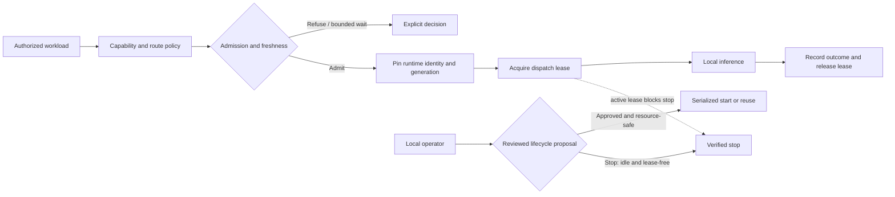

# Physical qualification — public engineering summary

**Observation window:** 21–22 November 2026  
**System:** HALO Control private implementation, one AMD Halo local workstation  
**Status:** operator-supervised, single-host **physical acceptance passed for the limited scope below**; **not production certification**

This document is a **sanitized summary** of internal, date-stamped acceptance records from the private implementation. The raw device logs, process identities, host/network configuration, binary digests, grants, and operator credentials are intentionally not published. This is a project-maintained report, **not an independently audited result**. The code in this repository remains illustrative rather than the private runtime implementation.

## What changed since the October public edition

The earlier public profile described a pre-hardware architecture. By 22 November, the private system had progressed from mocked and local-only tests to real local inference, measured resource observation, serialized workload admission, governed runtime lifecycle, and operator-reviewed release activation on an AMD Halo workstation.

The underlying design still separates:

1. **Control plane:** authenticated application capability requests, versioned model routes, admission and dispatch decisions, activity evidence, operator policies.
2. **Compute plane:** independently supervised model processes, observed runtime identity, resource headroom, lifecycle actions, durable operational records.
3. **Control Room:** read-first inspection and explicit operator-approved actions. UI state is not taken as proof that a model is running.

## Acceptance matrix

| Capability / invariant | What was exercised on hardware | Result and limits |
| --- | --- | --- |
| Local model inference | A governed Qwen3 4B-class runtime answered real requests through HALO | **PASS** for approved local requests; not a cloud or public deployment |
| Observability | Runtime ownership, process residency, memory/VRAM attribution and request completion were cross-checked against host observations | **PASS** for observed signals; unknown telemetry remains unavailable, not estimated |
| Inference admission | Work was admitted only while resource and backend occupancy checks allowed it, with bounded global concurrency | **PASS** for controlled test cases; no broad saturation or throughput claim |
| Release activation | Compatible Core and daemon release artifacts were activated as a coordinated pair; previously approved runtime restored | **PASS** in a maintenance window; rollback procedure prepared but not claimed as executed in this acceptance |
| Second runtime start | A separate Qwen3 14B-class runtime was registered without automatic routing, then explicitly approved and started | **PASS** with resource-headroom checks; no automatic download, eviction or fallback |
| Runtime dispatch integrity | Sequential requests to the 4B and 14B runtimes were attributed to the selected, pinned runtime generation | **PASS** for the exercised requests; no simultaneous cross-model generation test |
| Duplicate-start prevention | An approved start request against an already resident runtime reused the existing process rather than creating another | **PASS** with stable runtime identity |
| Busy-stop safety | Stop was refused while an in-flight request held a dispatch lease; the request completed without interruption | **PASS**; authorization does not override an active lease |
| Governed safe stop | Once idle, the second runtime stopped and released observed GPU memory while the first remained available | **PASS** under the tested idle condition |
| Shared-workstation isolation | Existing external inference workloads were left untouched by HALO lifecycle operations | **PASS** for this maintenance window; not proof of all possible workloads |

These results are from operator-maintained acceptance evidence, not a public benchmark corpus. A PASS covers **the stated test boundary only**.

## Admission and lifecycle design

Key principles:

- **Registration is not readiness:** known model definitions do not imply installed weights, an approved grant, a running process, or a valid route.
- **No silent cross-runtime fallback:** a request is pinned to one approved runtime identity. Stale or mismatched generations are rejected.
- **Operator approval is necessary but not sufficient:** low headroom, uncertain identity, active dispatch or backend occupancy can still refuse a lifecycle action.
- **No unmanaged process control:** the compute plane operates on registered and owned processes, not arbitrary host processes.
- **Evidence classes are explicit:** deterministic tests, simulated failures, observed machine facts and accepted real inference are separate claims.

## Verification types

| Evidence tier | Meaning |
| --- | --- |
| Contract and deterministic test suites | Run local logic without claiming hardware behavior |
| Isolated process/fault tests | Exercise errors and recovery under controlled local conditions |
| Physical acceptance (21–22 Nov 2026) | Real local model requests and lifecycle observations on a single AMD Halo host |
| Operational endurance / external adoption | **Not established** by this report |

The private VC-06B implementation record reports **58/58 deterministic infrastructure scenarios** and **9/9 local process-fault scenarios** passing before the physical acceptance. These are project-maintained results; the complete suites and raw logs are not part of this public edition.

## Current limitations

- A **single-machine, local-operator pilot**; not a general-purpose cluster scheduler, enterprise platform or remotely administered service.
- Maximum global active inference count is deliberately conservative. **No concurrent cross-model generation or saturation benchmark** was performed in this qualification.
- No claim of unattended multi-day stability, production SLOs, independent security audit or wide user adoption.
- Rollback instructions and release artifacts exist, but this acceptance did **not** demonstrate every rollback or disaster-recovery scenario.
- The public repository does not include the private executable implementation; its examples and screenshots are synthetic.
- VRAM and memory observations are not additive on a unified-memory machine. Reports avoid extrapolating capacity from a single run.

**Last sanitized sync:** 22 November 2026. This file supersedes pre-hardware claims in the October public profile; it does not imply that every capability has production-level evidence.
