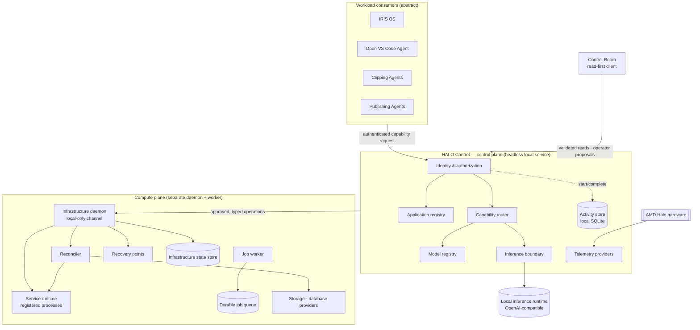

# Architecture

> Public edition: responsibilities and boundaries, not implementation.

## Planes and authorities

| Concern | Authority |
| --- | --- |
| Which applications exist and what they may request | Control plane (application registry) |
| Which models exist and what they can do | Control plane (model registry) |
| Which model serves a capability | Control plane (routing policy) |
| What actually ran, and how it ended | Activity store |
| Desired workload state (storage, database, jobs, services) | Control plane (workload registry) |
| Operator authorization and approval | Control plane (operator governance) |
| Actual service/process state | Compute plane (reports it; control never invents it) |
| Job truth, storage and database allocations | Compute plane (state store + providers) |
| Infrastructure audit trail | Compute plane events, correlated by operation id |
| Hardware facts | Telemetry provider, tagged with evidence class |

**Control says what should happen, the compute plane executes only pre-registered operations, and the compute plane reports what actually happened.** Registered (application registry), provisioned (compute allocation) and running (compute observation) are three separate facts.

The private hardware pilot now exercises this inference path with real local models: application → inference API → capability router → model registry → admission and runtime-identity pin → compute-plane runtime → local model. The runtime generation and dispatch lease remain bound to the admitted request. See the [public physical acceptance summary](PHYSICAL_ACCEPTANCE_2026-11-22.md). The implementation is not included here.

## Request lifecycle

1. A workload sends a capability request (for example `coding`) with its local credential.
2. **Authenticate, then authorize:** is the workload known, enabled, and granted this capability? If not, it is denied before anything else runs.
3. An activity record is opened (`running`).
4. **Route:** capability → registered, enabled, capable model (see [capability-routing.md](capability-routing.md)).
5. **Admit and pin:** refuse stale/uncertain occupancy or inadequate resource headroom; bind an approved resident runtime identity and generation to the request. No implicit cross-runtime failover.
6. **Dispatch:** acquire the runtime lease and infer through the local provider boundary. Lifecycle stops refuse while leases are held. Provider addresses and credentials remain server-side.
7. **Complete and release:** record a typed outcome and latency, then release the lease. Prompts/responses are not retained in activity history.

## Design properties

- **Headless core.** The UI is a client. Closing the Control Room or a desktop shell doesn't stop HALO.
- **Contracts at every boundary.** Every response is validated at runtime, including in the browser before it is rendered.
- **Mock and live evidence are kept apart.** Every observation carries an evidence class (see [telemetry.md](telemetry.md)).
- **Fail closed and fail visible.** Disabled inference, an unreachable compute plane or degraded history show up as explicit statuses, never as fabricated values.
- **Failure isolation.** If the compute plane is down, the control plane keeps serving unrelated APIs.
- **No model authority.** No model, agent or prompt takes part in authentication, authorization, approval or execution gating.
- **Safe multi-runtime lifecycle (private pilot).** Serialized, resource-gated start/reuse; dispatch leases; refusal of unsafe stops; verified resource release. Physically exercised on a single AMD Halo host in November 2026, not proven at multi-user production scale.

Detail: [service-runtime.md](service-runtime.md) · [operations-and-recovery.md](operations-and-recovery.md)
